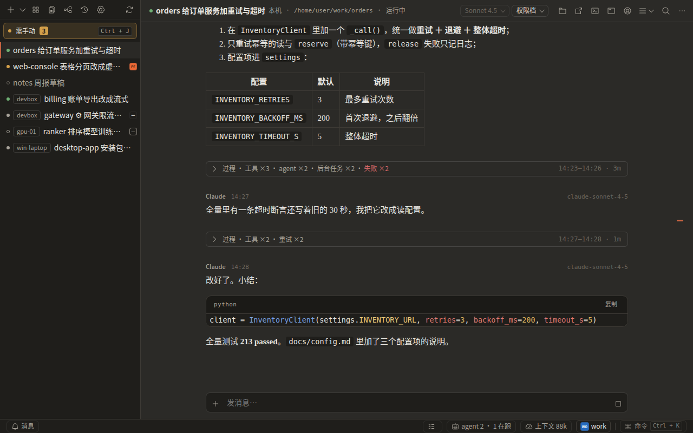
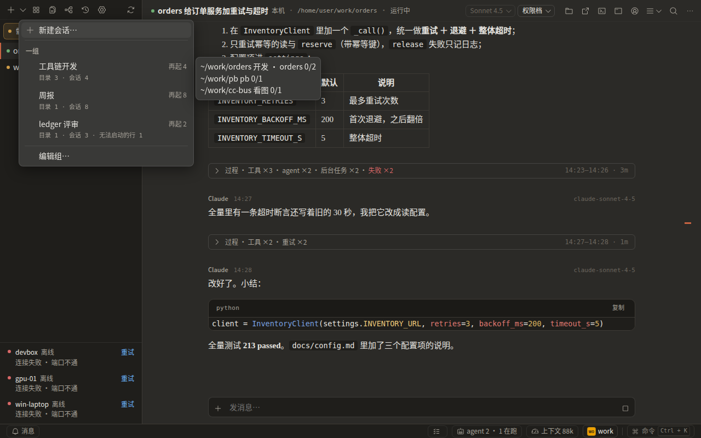
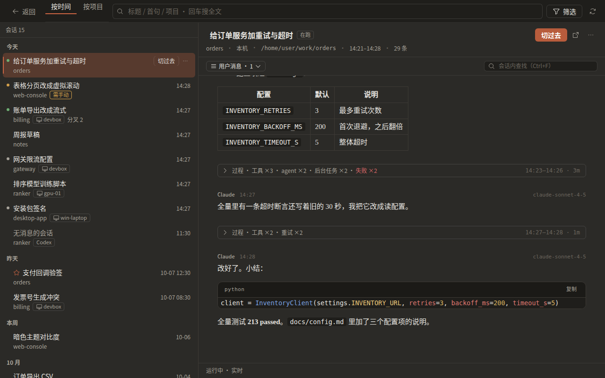
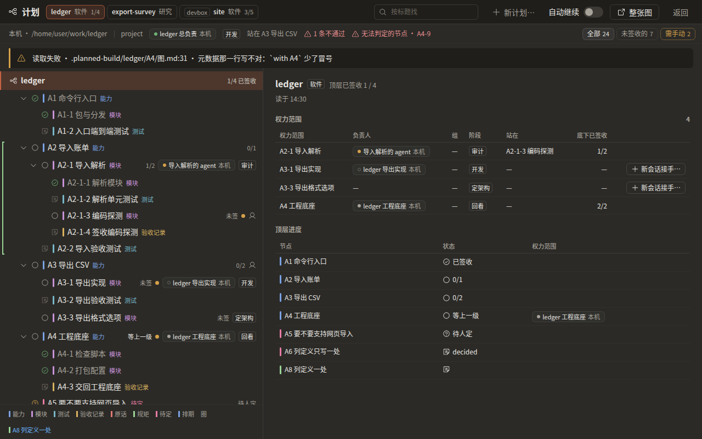
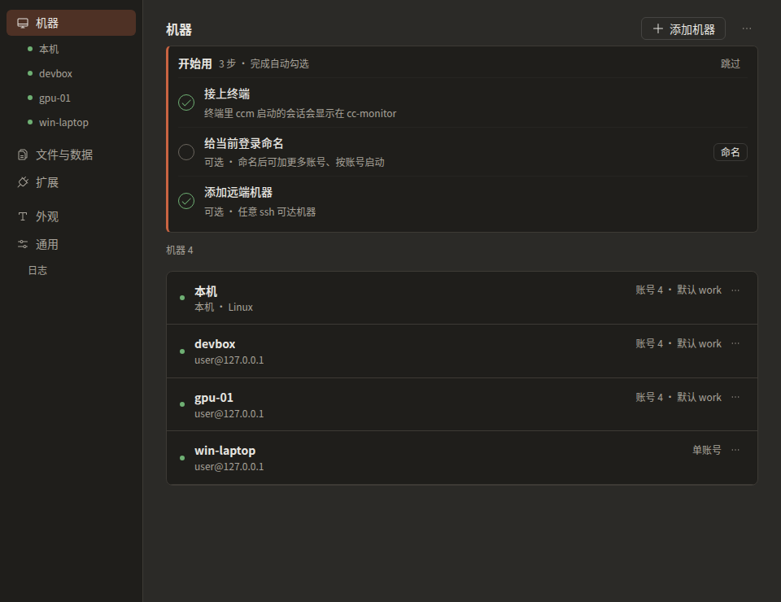
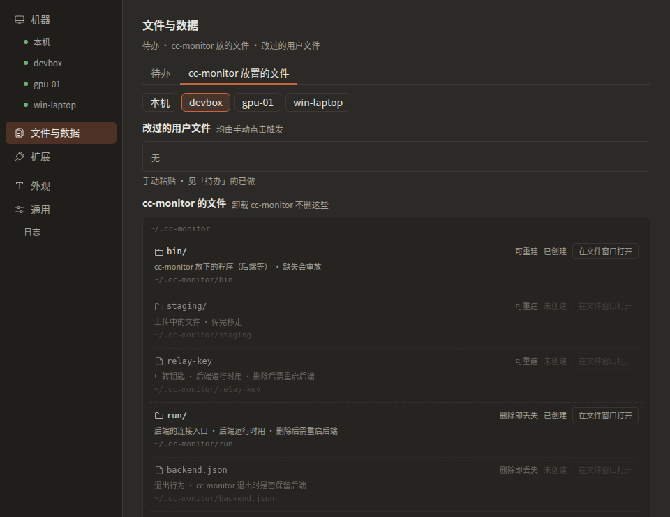
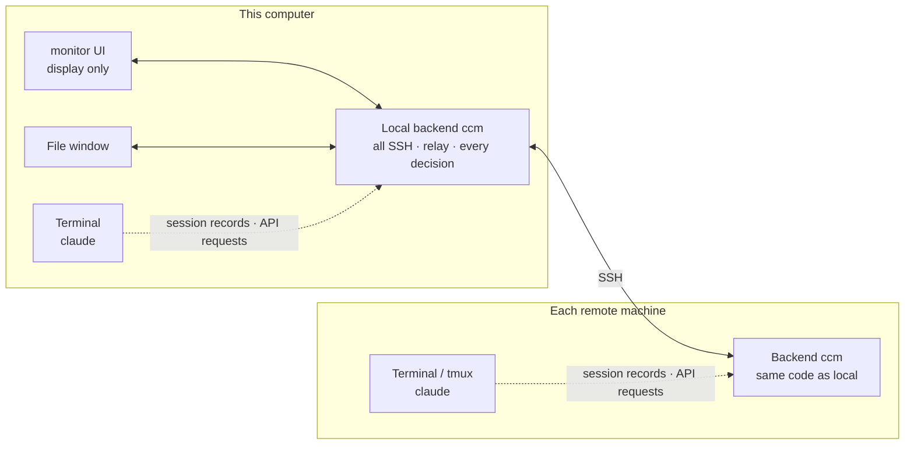

# cc-monitor

**All your Claude Code sessions, on every machine, in one window: watch them live, jump back in, and manage every machine from one place.**

> English · [中文](./README.md) | License: MIT | Platform: Windows 10/11 · Linux (.deb) · Android phone app (.apk) | Version: see [Releases](https://github.com/bo0Zeng/cc-monitor/releases) / [CHANGELOG](CHANGELOG.md)



> The interface is in Chinese; screenshots are taken from it.

---

## What it does

You run `claude` in a terminal — often several at once: one or two on your laptop, a few more on servers. cc-monitor gathers them all into one window:

- **One tab per session, live.** Messages, code and tool calls (reading files, editing files, running commands) appear as they happen, for local and remote sessions alike.
- **Back to the terminal in one click.** Press ↗ on a tab to bring the terminal running that session to the front and keep typing.
- **Full history.** Search past sessions across machines, fork a new session from any turn, or resume where you left off.
- **Many machines, one place.** Add a machine over SSH and its sessions show up automatically; start new sessions there and manage files without logging in.
- **Several accounts at once.** Subscription accounts and API-key accounts in one list; two accounts can run side by side without logging each other out.

`claude` is still the official one, and cc-monitor reads the session records it writes. By default a session runs in a terminal hosted by cc-monitor: closing the terminal window leaves the session running, and it can be re-attached or taken over at any time; tmux or a plain terminal still work too.

---

## Features

### Sessions
- One tab per running session; ended sessions turn grey and can be resumed from the right-click menu
- Markdown, syntax highlighting and math; tool calls fold into cards and file edits can be expanded
- Long sessions stay fast: only what is on screen is rendered
- Find in session, outline navigation, task panel
- Tabs can be grouped, pinned, or popped out into their own window
- Select several tabs (Ctrl-click, Shift-click for a range) and stop, start, pin, group or close them together from the right-click menu
- ↗ on a tab brings the terminal window that is showing that session to the front; for remote sessions it finds whichever terminal is attached right now, no matter who opened it
- "Reload" on the tab bar re-syncs every tab with the records on disk
- Answer in the message stream: approve a step · deny with a reason · answer a question · approve a plan; the terminal still works too, and whichever answers first wins. A question can be set to get an automatic reply after a few minutes with no answer; the answer block can be collapsed
- While a turn is running and the input box is empty, ➤ turns into ■, which stops the turn
- The "needs attention" overlay and `Ctrl+J` put the riskiest items first; tabs and the window title show the count
- The session header can switch the model and the permission mode; sub-sessions started from inside a session stay out of the tab bar by default, and any session can be hidden or shown again
- Attachments: drop a file anywhere on the main area and it goes with the next message, or upload it into the session's working directory
- Input queue: a message first joins that session's queue and is sent in order once the session is idle; unsent ones can be withdrawn. While the machine is offline it waits as a draft and is delivered on reconnect
- Edit a sent message in place, then rewind and resend using the rewind options the machine offers
- Start a group of sessions: save a group and start it in one click, filling in whatever is missing; rename a tab in place (`F2`)



### Terminals
- Hosted terminals: sessions run by default in a terminal hosted by cc-monitor and survive closing the window; take over input · hand back · end, and a terminal window attached to it can still type
- Terminal view: every machine's terminals, grouped by machine; pick one to see it drawn; any terminal can also open in its own window
- Sessions can still go into tmux or a plain terminal; where a resumed session goes is a setting (hosted terminal · tmux · same as when it started)

### History
- Browse every session by machine and project, with full-text search
- Fork from any turn: the original stays untouched and the new session starts right away
- Star, rename, hide



### Plan page
- Reads a planned-build plan graph: outline, block table (can be viewed by group), cell detail; rules show which cells they cover, and evidence such as acceptance records has a look of its own
- "Ask the graph…" in a cell's detail header opens the ask box; "New plan…" sits in the page header; the group menu jumps to the blocks that group has taken on



### Machines
- Add SSH machines (or import from `~/.ssh/config`), with jump hosts and automatic choice of the fastest address
- On first connect the backend is installed to `~/.cc-monitor/bin/ccm` on that machine and kept at the right version
- Start remote sessions (in a hosted terminal or tmux), open a terminal, forward ports
- Every connection lists readings for each hop and marks hops through a jump host or a proxy; typing a machine name in the command palette goes straight to what can be done on it
- Machine strip at the bottom of the sidebar: one line per machine that is not connected, with the reason and the first fix
- Settings → "Files and data": "To do" lists what each machine is missing; "Files cc-monitor placed" lists, machine by machine, what cc-monitor put there and whether it can be recreated if missing
- Local paths listed in Settings can be shown in the system file manager; files placed on a remote machine open straight in the file window





### File manager
- A separate window for files on a remote machine (a local session's working directory opens in the system file manager)
- Same colours and fonts as the main window; back / forward, an editable address bar, a sidebar (bookmarks · this machine · other machines), a details list (resizable columns, click a header to sort) and a status bar
- Search as you type across the whole home folder, with the common Everything syntax (space = and · `|` or · `!` not · `*` `?` · `ext:` `path:` `file:` `folder:`)
- Create, rename, delete, copy, change permissions, upload and download, bookmarks, search by content; "Properties" in the right-click menu; preview with syntax highlighting and images
- Select a group and copy, delete, change permissions, upload or download it at once; name clashes are asked item by item, and failed items can be retried on their own
- Images open in a viewer (zoom · previous / next); text files open in an editor on double-click
- On remote machines it can do everything SSH can do to files

### Accounts and relay
- Subscription accounts (official Claude login) and API accounts (custom URL and key) in one place
- Two accounts can run at the same time: separate login credentials; skills, memory, settings and the other items Claude Code is known to share are shared, anything it does not recognise stays per account
- An API key stays on its own machine and is only injected when a request passes that machine's relay — never on the command line, never in the environment
- Sign in to subscription accounts and MCP servers inside the app; when one account signs in to (or refreshes) an MCP server, the other accounts get the same login
- Account rotation: switch to another account when quota runs low and keep going. Rules are strategies, edited in Settings or the session panel (account list · order · thresholds · time slots · smart switching) or written by hand; each session keeps its own copy, can switch on the spot and can dry-run the result; sessions without automatic switching can still switch by hand from the session panel
- Outbound traffic follows the proxy: for a session started with a proxy set (`HTTPS_PROXY` and the like), the relay reaches upstream through that proxy too; the backend dials SSH through this machine's proxy settings as well
- A session with `ANTHROPIC_BASE_URL` set by hand still goes through the relay and is forwarded unchanged, without quota tracking or account switching

### Messages between sessions (cc-bus)
- A mailbox with a doorbell between sessions (Claude Code · Codex): one entry point, `cc-bus <verb>`; the inbox and the delivery rules live in the backend, messages only reach sessions in the same tab group, and they can cross machines

### Phone app (Android)
- Connects to the same machines: read sessions, keep chatting, open a terminal, manage files (with multi-select, and search by file name or content)
- The chat screen's top bar shows the session name and "machine · directory"; the session info drawer shows where it runs, which account it uses, who is writing and what is running in the background
- Approve steps, answer questions and approve plans on the phone; see each account's usage and change rotation
- Overview: one list per machine of everything waiting on a person (sessions waiting · plan items to review · accounts and MCP servers that need a sign-in), one tap away from the top-right of the chat screen
- Install or upgrade the backend on a machine; SSH runs on the same core as the desktop (jump hosts · passwords · host key checks)
- Attachments (camera · images · files), the input queue and drafts, editing a sent message; the session list is split by tab group
- Plan page (slices · outline · cell detail), agent list; the terminal page lists each machine's terminals; where a new or resumed session goes is decided by that machine (hosted terminal or tmux)

### Assets
- Push and pull skills and MCP servers between machines; review the differences first, and uninstall what was installed
- The extensions page recognises planned-build and code-picture

### Aliases and `ccm`
- The machine page's Terminal tab first shows whether this machine's shell is hooked up; aliases are listed in two groups (accounts, others), added in place and saved in one step (bash, zsh, PowerShell)
- Every new account gets two aliases: `<name>cc` starts in a hosted terminal (typed inside a tmux pane, it stays in that pane), `<name>cct` starts inside tmux; removing the account removes them
- Aliases can carry a tab group (`--tab-group`) and a first message (`--say`)
- The working directory can depend on where the command is typed: in `~` go to some directory, elsewhere stay put (`--cwd-if`)
- `ccm` wraps `claude`, see below

---

## Architecture



- **One backend, two hosts.** This computer and every remote machine each run one long-lived backend, built from the same code. It reads session records, owns the SSH connections, makes every decision and does all the writing.
- **The UI only displays.** It talks to backends with just two verbs — call and subscribe — and never touches SSH itself. The Android app is a second UI; it dials SSH itself to reach the same backend.
- **One home per machine.** Everything cc-monitor owns lives in `~/.cc-monitor/`. In Claude Code's `~/.claude` it normally only reads sessions; it writes there only when asked to fork or delete a session, install or remove a skill / MCP server, or enable multiple accounts.

More detail in [`src/doc/ARCHITECTURE.md`](src/doc/ARCHITECTURE.md).

---

## Install

### Requirements

Install [Claude Code](https://github.com/anthropics/claude-code) first and run it at least once.

| Platform | Needs |
|---|---|
| **Windows** 10 (1809+) / 11 | [WebView2 Runtime](https://developer.microsoft.com/microsoft-edge/webview2/) (built into Windows 11) |
| **Linux** x86_64 | WebKitGTK 4.1 (Debian / Ubuntu: `libwebkit2gtk-4.1-0`, pulled in by the `.deb`) |
| **Remote machines** | Linux (x86_64 / aarch64) reachable over SSH; sessions run in hosted terminals by default, tmux is optional (the plan page's "Ask the graph…" needs tmux). Nothing to install by hand |

### Download

Get the latest version from [Releases](https://github.com/bo0Zeng/cc-monitor/releases).

- **Windows**: `*-setup.exe` (recommended) · `*.msi` (for managed deployment) · `cc-monitor.exe` (portable)
  The build is unsigned; on first run SmartScreen will stop it — choose "More info → Run anyway".
- **Linux**: `cc-monitor_<version>_amd64.deb` (`sudo apt install ./cc-monitor_<version>_amd64.deb`) · `cc-monitor` (portable)

The downloaded `cc-monitor.exe` (`cc-monitor` on Linux), or the installed app, is the project itself: it contains the frontend and the backend, and it releases the backend onto every machine it uses.

Checksums are in `SHA256SUMS.txt` (Windows) and `SHA256SUMS-linux.txt` (Linux).

### First steps

1. Open cc-monitor (on Linux the command is `cc-monitor`).
2. Run `claude` in any terminal; a new tab appears in cc-monitor.
3. Add a remote machine: press `,` for Settings → Machines → Add machine. Once connected, its sessions appear automatically.
4. To make ↗ jump back to the terminal, install the alias block from the machine page and start sessions with `cc`.

---

## The `ccm` command

On every machine, `~/.cc-monitor/bin/ccm` is that machine's backend and also a wrapper around `claude`:

```
ccm [arguments for claude…] -- [ccm's own options…]
```

Without `--`, the whole line goes to claude unchanged.

```bash
ccm                               # same as claude
ccm -p "explain this repo"        # arguments go straight to claude
ccm -- new --ccm-tmux             # start in a new tmux session
ccm --resume <session-id> -- --ccm-tmux   # continue a session; attach if it is already running in tmux
ccm -- --account work             # start with the "work" account
ccm -- --cwd-if ~ ~/work          # typed in ~ ⇒ start in ~/work; elsewhere start in the current directory
ccm -- --attach <session-name>    # re-attach a hosted terminal or a tmux session
ccm -- --commands                 # every backend command
ccm -- --ccm-help                 # all options
```

---

## Keyboard shortcuts

Single keys, all changeable in Settings → Shortcuts.

| Key | Action |
|---|---|
| `[` / `]` | Previous / next tab |
| `1`–`9` | Jump to tab N |
| `` ` `` | Bring the session's terminal to the front |
| `H` | Toggle history |
| `T` | Task panel |
| `E` | Open the tab's working directory |
| `W` | Close ended tabs |
| `,` | Settings |
| `F2` | Rename the current tab |
| `Ctrl+N` | New session |
| `Ctrl+K` | Command bar |
| `Ctrl+F` | Find in session |
| `F11` | Full screen |

---

## Where data lives

| Location | What |
|---|---|
| `~/.cc-monitor/` | Everything cc-monitor owns: settings, backend, logs, alias files, API keys (readable only by their owner), and the multi-account store `accounts/` (built and maintained by the backend: the account list, plus one set of login credentials per account) |
| `~/.claude/` | Claude Code's own directory. cc-monitor reads session records; it writes only when asked: forking creates a new session record, deleting a session removes it, installing / removing skills and MCP servers, and enabling multiple accounts moves this machine's login into the account store |

The "Data locations" page in Settings shows the full path of every file.

---

## Known limitations

- Windows has no tmux: sessions run in hosted terminals there (they can still go to the background, be re-attached, be viewed and be typed into), and the plan page's "Ask the graph…" is not available on a Windows machine.
- macOS is not supported, neither as the local machine nor as a remote one; Linux arm64 works as a remote machine only.
- Multi-account on Windows needs permission to create symbolic links: turn on Developer Mode (Settings → System → For developers) or run cc-monitor as administrator; without either the account store cannot be set up, and the accounts page says so.
- The Windows side has been regression-tested in a Windows 11 virtual machine (copy-details, icons, hosted terminals, the terminal drawer, the file window, ↗ bringing the right window and the right Windows Terminal tab forward, terminals opened as administrator).
- ↗ only brings the window forward (and says why) when the tab name does not follow the program title (renamed by hand, or "suppress title changes" is set) or the tabs cannot be read; terminals connected through a jump host or port translation cannot be matched.
- The signed Android app ships with each Release (`cc-monitor-<version>.apk`) under the same version number as the desktop; the backend on a machine it connects to must be the same version, otherwise it says the machine needs an update and installs only when asked.
- Sessions started through a custom launcher (`--launcher` and the like) can answer approvals in the message stream on Linux only; on Windows they still answer in the terminal.
- Hosted terminals do not handle OSC 8 links, OSC 9 / 777 notifications or the kitty keyboard protocol. Synchronized output has no timeout: a program that turns it on and never turns it off leaves the screen unpainted.

---

## Development

- Building and developing: [`src/doc/BUILDING.md`](src/doc/BUILDING.md) · [`src/doc/DEVELOPMENT.md`](src/doc/DEVELOPMENT.md)
- Mobile app (Android): [`src/mobile/README.md`](src/mobile/README.md)
- Contributing: [`src/doc/CONTRIBUTING.md`](src/doc/CONTRIBUTING.md)
- Release notes: [`CHANGELOG.md`](CHANGELOG.md)
- Test counts are whatever the suites report when run; how to run them is in [`src/doc/DEVELOPMENT.md`](src/doc/DEVELOPMENT.md)
- Releases ship only with CI green; the jobs are listed in [`.github/workflows/ci.yml`](.github/workflows/ci.yml)

## Status

- current version: see [Releases](https://github.com/bo0Zeng/cc-monitor/releases); what changed in each: see the [CHANGELOG](CHANGELOG.md)

## License

MIT
